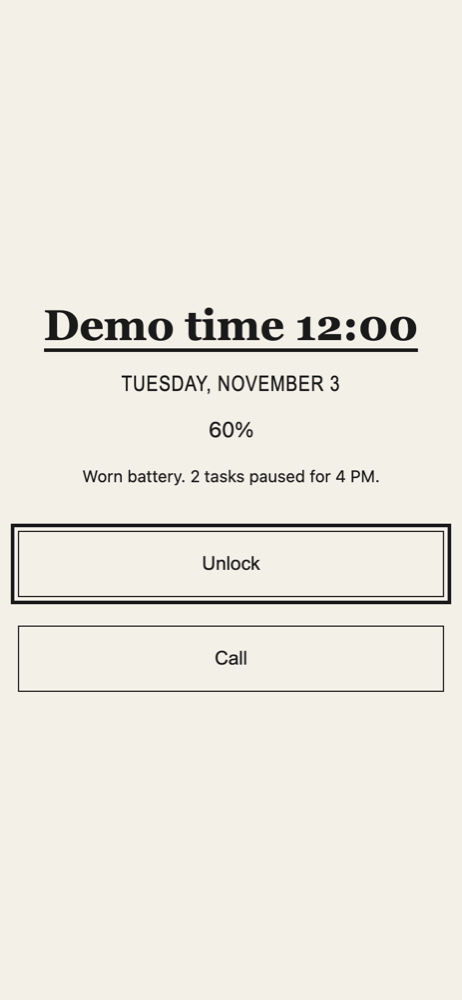
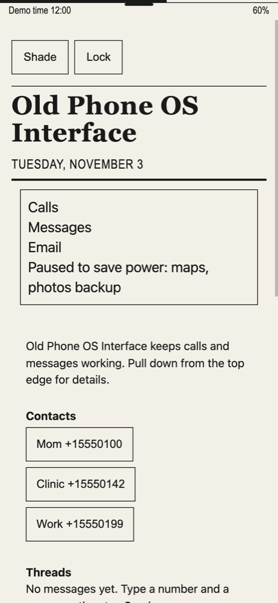
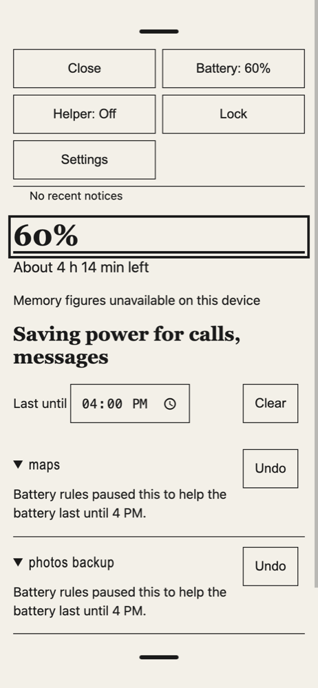
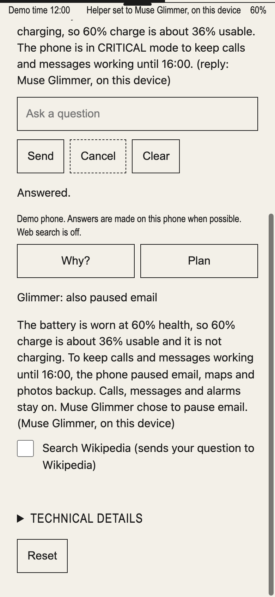

<!-- SPDX-License-Identifier: GPL-3.0-or-later -->
# Old Phone OS (OPOS)

Old Phone OS (OPOS) is a phone interface for the Microsoft Surface Duo 1. It is the only interface, across both screens, of a Linux image built on the community Droidian port for the Duo. Droidian supplies the kernel, the drivers and the system services; OPOS supplies everything the owner sees and the battery rules. It is designed to keep calls and messages available and to pause less essential work toward a time the owner chooses. It is for people who rely on an older phone, whatever their age or budget.

OPOS is a work in progress and is not yet a complete phone operating system. The image starts only when booted from a PC, calls and texts are simulated, and nothing below has been measured for speed, battery life or stability. Do not rely on it to call for help.

## Surface Duo status

| Area | State |
|---|---|
| First run on the phone | November 7, 2026: the OPOS-only image ran on one Surface Duo 1, RAM-booted from a PC: the kernel is started from the PC each time and the phone's boot partition is not changed, so a power cycle returns it to Android. |
| Duo OS image, checkpoint 1 | Pull request #10 says this image was accepted on the device on November 8, 2026 for touch, the Hand setting, the on-screen keyboard and Settings. The files in this repository record the November 7 RAM-boot. They do not record that November 8 session on their own, and they do not record a flashed boot partition. |
| Duo OS image, checkpoint 2 | Pull request #10 says a later image was built and that its install and selftest were not checked independently. |
| Calls and texts on the Duo | Still simulated. The ModemManager adapter is not wired in. |
| Starting without a PC | Not yet. A persistent install is planned, not run. |
| Speed, battery life, stability | Not measured. |
| Over-the-air updates | Implemented and tested on Linux with stand-ins. Not tested on the phone. |
| postmarketOS packaging | Booted to the lock screen in QEMU on November 3, 2026. Not booted on a phone. |
| Windows installer | Untested at runtime. |

Start with:

- [The Duo OS as it stands](docs/duo-os-final.md): what the OS does, what is simulated, and what is not known.
- [OPOS OS for the Surface Duo](packaging/duo-os/README.md): the image, how it is built and installed, and how to restore Android.
- [Duo OS acceptance](docs/duo-acceptance.md): the on-phone selftest and the owner's checklist.
- [OPOS on a stock-Android Surface Duo](docs/duo-android.md): running OPOS in Termux without flashing.

## Hackathon reference

This was a hackathon project. The desktop demo, the public demo and the rest of this README describe the earlier prototype, Louis Calata's solo entry in the Meta Global AI Developer Hackathon with Cerebral Valley (November 2026). It is kept as a reference. The battery rules and the helper it introduced are the base of the Duo OS. [Watch the demo video](https://youtu.be/ZiFa_5aUD_Y). Meta model developers: see the [field report](docs/meta-model-field-report.md).

## Quickstart — under five minutes

Requires **Python 3.11+ and a web browser**. No package installation, account or model download is needed. Open a terminal in the extracted folder containing this README, then run:

```sh
PYTHONPATH=src python3 -m opos.web --port 8765
```

Open **http://127.0.0.1:8765/?demo=1** for the unlocked simulator controls. **Leave this terminal running; Ctrl-C to stop.** Or [open the public demo](https://opos-demo-production.up.railway.app), which answers from battery rules with Glimmer off.

In this demo the battery, calls and messages are simulated; the Surface Duo routes that read a real battery are described under [Limits](#limits), and on-phone Muse inference is untested. The noon panel's estimate is a snapshot: a separate recorded rules-only noon-to-16:00 run, with no model or owner overrides, displayed **0% at 16:00; goal not met (`goal_met=false`)**.

## Try the battery features

Use `?demo=1`, leave simulation paused, and follow these rows in order. Close battery details with **Escape** before using the sliders. The quoted text below was checked in a headless browser; model-free desktop and public helper behavior differ as noted.

| Feature | What to do in `?demo=1` | What you see |
|---|---|---|
| Goal and time left | At the initial 60%, open the thin top battery bar. Read **Last until** (16:00, shown as 04:00 PM in some locales); it is editable. | “About 4 h 14 min left”. This is the current estimate, not a guarantee of reaching 4 PM. |
| Soft pauses and Undo | **Before lowering Battery**, click **Undo** beside maps at 60%. | “Maps” returns; only “photos backup” stays paused. The estimate becomes “About 2 h 59 min left”. |
| Low-battery floor and resting helper | Close details, click **Show helper** (skip if it already reads Hide helper), set **Battery** to 20%, then Ask “Why are maps paused?”. Open details and expand a paused task's reason. | “Paused to save power: email, maps, photos backup”; “Battery rules paused this because usable battery is low.” Desktop Ask says “Battery is critical, so the helper is resting to save power.” Calls and messages stay allowed; these hard pauses have no Undo. Public Ask instead explains the rules. |
| Charging | Close details and tick **Charging** at 20%, with Temp at 30°C. Open the top bar. | “Charging”; email, maps and photos backup return. Charging lifts the low-battery floor, but not heat or the absolute call reserve. |
| Heat floor | While charging, close details and set **Temp (°C)** to 45. Open details and expand a paused reason. | “Battery rules paused this because the phone is hot.” Only calls and messages stay allowed in this demo. |
| Call reserve | Restore Temp to 30°C, keep **Charging** checked, and set **Battery** to 0%. Open details and expand a paused reason. | “Battery rules paused this to keep a battery reserve for calls.” The absolute reserve engages at **0.7% charge or less**, even while charging; this shows it independently of the low-battery floor. |
| Plan's saving steps | Restore **Battery** to 60%, untick **Charging**, close details and click **Plan**. | “dim screen > short screen timeout > batch sync”. Plan proposes the order; it does not run those steps. |
| Worn battery / usable charge and Why? | At the restored 60%, click **Why?**. | “The battery is worn. It holds 60% of what it did when new, so 60% is really about 36%”: 60% charge × 60% health ≈ 36% usable. On a real phone whose health was never read, the sentence says only “The battery is at 60%”. The explanation names maps and photos backup; locally it ends “Rules text. The helper did not answer this request.” |

The call reserve above is separate from the **worn-battery reserve**: the latter requires health below 50%, no charging, and charge within its reserve margin. This demo fixes health at 60%, so that reserve stays off and cannot be tried with its sliders. The general measured reserve can also include one hour of observed drain; that added amount is waived with a daily goal while unplugged and below 45°C. See [the hard floors](docs/design-safety-floor.md).

Demo walkthrough:

1. Open `http://127.0.0.1:8765/?demo=1`; the controls start unlocked. Use the table above for the battery tour.
2. The demo starts at noon, 60% charge, 60% health: about 36% usable, goal 16:00. The rules pause maps and photos backup toward that goal; calls, messages and email stay on. The lock screen calls health below 80% worn, but the worn-battery reserve needs health below 50%, which these controls cannot change. The panel is a snapshot; the separate four-hour rules-only run displayed 0% and missed the goal. With a configured Muse Glimmer server and the helper shown, its background advisor may also pause email; it cannot turn maps back on.
3. At the initial 60%, open the top battery bar and **Undo** maps before dragging Battery down. Close details, click **Start simulation**, watch the demo time and battery change, then **Pause simulation**.
4. At 20%, enter `+15550100` and a message, then click **Simulate incoming text**. Click **Call**, then **Hang up**. These actions are simulated.
5. Restore Battery to 60% and click **Show helper** if hidden. Without a model answer, **Why?** explains the battery rules and **Plan** keeps its fixed saving order. **Ask** reports that no model answered; use Why? for a rules explanation. At 20%, desktop Ask instead returns the resting explanation. The public demo's Ask always answers from rules.

Installation and developer tests are optional; the demo ends here. Stop the server with **Ctrl-C**.

## The scenario and its limits

You keep an older phone whose worn battery usually dies by mid-afternoon. With OPOS, maps and photo backup stay paused while calls and messages stay on. The call that matters in the evening still comes through. This is the scenario the simulation models.

Scenario written by Meta Muse Spark 1.3 via Gumloop, reproduced verbatim; it is not a measured phone result.

OPOS is a prototype phone interface for people who keep an older phone as its battery wears out. It pauses less essential work such as email, maps and photos backup **toward a time the owner chooses**, while calls and messages stay allowed. Optional open-weight Meta Muse Glimmer 30B runs on the owner's computer, explains decisions when asked, and may pause extra tasks. It never re-enables anything the rules paused or touches calls, messages or alarms; the rules work without it. The postmarketOS kiosk runs the same simulation: it does not yet read the phone's real battery or use its modem.

<p>
  
  
  
</p>

Screenshots of the desktop simulation (battery, calls and messages are simulated).

## Muse Glimmer answering

On November 3, 2026, the OPOS desktop demo (`?demo=1`) ran on Louis's MacBook Pro with LM Studio serving `muse-glimmer-30b` (Meta Muse Glimmer 30B). The simulation was at noon, with 60% battery at 60% health, a 16:00 goal and the helper shown. On-phone inference is untested.

Asked "Why are maps paused?", Muse Glimmer answered in **51.699 and 53.077 seconds in dark appearance** and **42.914 and 44.782 seconds in light appearance**. These are four individual measurements from activating the UI control to the displayed reply, including request and rendering time; they are not pure inference times or on-phone measurements. Successful answers identify Muse Glimmer and where it ran. The simulator's Ask appends `(Muse Glimmer, on this device)`; the Helper chat view uses `reply: Muse Glimmer, on this device`. Here, “this device” is the owner's MacBook Pro running the desktop demo.

The first dark capture's answer, verbatim:

> Maps are paused to save power. The battery is worn at 60% health, so a 60% charge is only about 36% usable and the phone is not charging. The phone paused maps and photos backup to keep calls and messages working until 16:00.

The light-theme Ask reply uses different wording, and its "CRITICAL" is not the battery rules' floor, which applies below 15% usable.

The first dark question was sent while maps and photos backup were paused. By the time the reply appeared, Glimmer's background advisor had also paused email. The visible status line in both selected Ask screenshots reads "Glimmer: also paused email" and matches the captured current task state; the answer describes the facts supplied when the question was sent.

<picture>
  <source media="(prefers-color-scheme: dark)" srcset="docs/assets/glimmer-ask-dark.png">
  
</picture>

The revised **Why? button returned Glimmer answers in 66.549 and 60.696 seconds in dark appearance, and 63.853 and 78.651 seconds in light appearance**. All four completed before OPOS's 115-second helper deadline; none used the rules fallback. These measurements replace the earlier pre-fix Why? deadline observations for this final source.

<picture>
  <source media="(prefers-color-scheme: dark)" srcset="docs/assets/glimmer-why-dark.png">
  
</picture>

| Appearance | Action | Run 1, seconds | Run 2, seconds | Result |
|---|---|---:|---:|---|
| Dark | Ask | 51.699 | 53.077 | Muse Glimmer; no fallback |
| Dark | Why? | 66.549 | 60.696 | Muse Glimmer; no fallback |
| Light | Ask | 42.914 | 44.782 | Muse Glimmer; no fallback |
| Light | Why? | 63.853 | 78.651 | Muse Glimmer; no fallback |

The screenshots use the first chronological run; both runs of each action and appearance are reported. The demo video is a separate later recording from the final source, with its own times: Ask 64.981 s, Why? 86.650 s and Plan 50.247 s, all answered by Muse Glimmer. The captured runtime is the staged Git tree `e753c23bba4f3898a09ae4e1f6f0137e255fde68` (a tree object, not a commit). Full replies, timestamps, task states and unedited PNGs are kept by the owner and are not in this repository. Battery, calls and messages remain simulated; Glimmer runs on the owner's computer.

## Try it online

[Open the public simulation](https://opos-demo-production.up.railway.app) —
simulation-only demo with no model; state resets after 15 minutes idle.
The browser demo gives each visitor a temporary phone with
simulated battery, calls and messages. It is not a phone operating system and
has not run on a physical phone. All public helper answers come from the rules;
Muse Glimmer runs only on your own computer.

Open `?demo=1` for controls. At the initial 60%, pull down the top bar
and Undo maps before lowering the battery slider. See [public-demo setup and limits](docs/public-demo.md)
for the separate Railway entry point, isolation and local run command.

## How it works

Battery state drives a rule decision, then an advisory plan and explanation. Model text cannot enable a task the rule router deferred.

Hard floors come first and nothing the owner does overrides them: calls, messages and alarms are always allowed (the desktop demo simulates calls and messages only); at 45 C or more only essential tasks run, charging or not; on battery, with less than 15% of the charge usable (the battery rules' CRITICAL mode), only essentials run; below a small reserve kept for calls (at least 0.7% charge) only essentials run, even while charging; and the worn-battery reserve, which engages only when battery health is below 50%, may pause other tasks, even the app in use, to keep charge for calls.

Within those floors the router decides what the battery can afford. While charging, other tasks may run. With a daily goal, the energy budget is cumulative: non-essential tasks are funded in a fixed order (useful before optional, then lower cost first, then by name) and each funded task's cost is subtracted before the next is checked. Without a goal, optional tasks need an effective charge of 80 or more and useful tasks need enough charge for 4 hours. Effective charge = level x battery health. The governor intersects the router's choice with its own rule floor, so model advice can only pause more.

Goal-saving pauses, the router's affordability pauses (even when the router reports CRITICAL) and pauses Glimmer adds are soft: the owner's Undo, or using the app in the foreground, may override them. An Undo lasts until the mode changes; a task held by a hard floor shows that floor as its reason and Undo has no effect on it. The mode shown (NORMAL, SAVER or CRITICAL) comes from the router and the battery rules; what runs is decided by the final allowed and paused lists, and each pause shows its reason. The home screen, battery panel, lock screen, helper facts and simulated drain all use the same final decision. See [docs/design-safety-floor.md](docs/design-safety-floor.md).

Agentic loop with visible helper: observe battery state -> decide with router -> plan (Plan proposes an order and does not run the steps itself) -> act -> explain -> undo. Helper text never changes what the phone does; Glimmer's background advisor can pause extra non-essential tasks, never fewer than the router.

Glimmer may only pause additional non-essential tasks. It cannot allow anything the router deferred and cannot touch calls, messages or alarms.

## Meta AI in OPOS

| Route | Purpose | Requirements and scope |
|---|---|---|
| Rules floor | Deterministic decisions and fallback text | No model or provider account. Simulations are not measured battery savings. |
| Muse Glimmer 30B | Routing advice, Why, Plan and Ask | Your own server serving the model id `muse-glimmer-30b` (for example LM Studio) at `http://127.0.0.1:1234/v1`. If port 1234 is taken, set `OPOS_GLIMMER_URL=http://127.0.0.1:<port>/v1` to point OPOS at LM Studio's actual port. The November 3 final-tree Ask and Why? UI response times are reported individually in [Muse Glimmer answering](#muse-glimmer-answering); these desktop measurements do not establish phone inference speed. |
| Llama 3.2 1B/3B | Optional phone-local answers via server at loopback port 8080 | About 1.5/4 GB free memory; phone speed is unmeasured; weights are not shipped. |
| User-owned LAN server | Optional Glimmer endpoint selected with OPOS_LAN_URL | Private-address validation; opt-in. OPOS does not expose a server for you. |
| Wikipedia | Optional snippets for one question | Unchecked-by-default Search Wikipedia option sends that question to Wikipedia. |
| Spark Open | Optional paid hosted route for Why and Plan only when battery estimate falls short of daily goal | Off by default. Needs `OPOS_SPARK_OPEN=1` and `BASETEN_API_KEY`. Ask does not use it. |

Check endpoint with:
```sh
PYTHONPATH=src python3 -m opos.muse --check
```
This check only lists the endpoint's advertised model IDs and `model_served` (whether `muse-glimmer-30b` is among them); it does not prove the model answers. Ask one question to verify a reply. `--check --probe` is an alternative that sends an additional completion.

## Simulation results

In the separate recorded rules-only noon-to-16:00 demo run (60% starting charge, 60% health, no model or owner overrides), the noon panel estimated about 4 h 14 min left. At 16:00 it displayed **0% and did not meet the goal (`goal_met=false`)**. This is distinct from the profile averages below.

The profile table varies a simulated battery-drain model across six profiles, without burst current; burst shaping applies only to the separate worn-battery hours evaluation below. These results do not establish battery savings or cut-out rates on real phones. All numbers below simulate the deterministic rule router against fixed rules, with no AI model involved; they are not measurements on a real phone.

Six simulated device profiles, 40 phones each. Important minutes are simulated minutes until the battery is empty or browns out, with calls, messages and alarms allowed throughout; useful minutes add up the minutes email and maps were each allowed to run. Each figure is the average over the 40 phones, rounded to whole minutes.

| Profile | Important minutes, router | Important minutes, rules | Useful minutes, router | Useful minutes, rules |
|---|---|---|---|---|
| Fresh battery | 743 | 437 | 252 | 403 |
| Worn battery | 518 | 325 | 23 | 180 |
| Cold | 619 | 376 | 105 | 281 |
| Hot | 619 | 378 | 104 | 283 |
| Low start | 156 | 155 | 0 | 1 |
| End of life | 338 | 225 | 0 | 88 |

The router buys important minutes by giving up useful minutes in every profile: it allows email and maps for fewer minutes than the fixed rules everywhere, far fewer with a worn battery, and none with a low start or an end-of-life battery.

The router figures in the table come from the full runtime, so in the worn and end-of-life profiles, where battery health can be below 50%, they include the worn-battery reserve's task pauses. A second simulation, of 40 phones with 30-40% battery health, adds the rest of the reserve: burst shaping, which limits call and sync current to what the worn cell can deliver. Each phone runs once with the policy alone and once with the reserve's task pauses and burst shaping added (the router's runs include the task pauses both times); the figures are the averages of those two sets of runs, not a range. Working calls lasted on average 5.52 and 6.54 hours for the router (fixed rules: 3.67 and 4.73 hours). In the first set every simulated phone browned out; in the second none did.

Reproduce: `PYTHONPATH=src python3 -m opos.profiles` (about 15 s) and `PYTHONPATH=src python3 -m opos.evaleol` (about 40 s).

## Install the per-user application

Optional installation for regular use. Skip this section for the browser demo; the quickstart above is sufficient.

On Windows, run `install.cmd` to invoke `install.ps1` with your arguments; the Windows runtime remains untested.

From a checkout of this repository:
```sh
sh install.sh --yes --no-launch
export PATH="$HOME/.local/bin:$PATH"
opos run --defaults
opos status
```

The installer keeps using that source checkout and creates a per-user launcher and virtual environment. Keep the checkout. `--no-launch` leaves setup for the later `opos run` step.

Optional bootstrap: `bootstrap.sh` clones the repository into `$HOME/opos-src` (or `OPOS_SRC_DIR`) and runs `install.sh --yes --no-launch` from that new checkout. The script itself is a file in this repository, so you need a copy of it first, from a checkout or downloaded on its own. If you already have a checkout, run `install.sh` from it as shown above instead.
```sh
OPOS_REPO_URL=https://github.com/louiscalata/old-phone-os OPOS_REF=main sh bootstrap.sh
```

## postmarketOS packages and QEMU

As recorded in [docs/pmos.md](docs/pmos.md), on November 3, 2026 a postmarketOS aarch64 image booted in QEMU 9.1.2 (TCG, OpenRC) to the OPOS lock screen, and Unlock reached Home. It used the packaged tinydm Pixman renderer hook without a manual renderer override; the same image without the hook stayed on the console with a GLES2/GBM failure. See [docs/pmos.md](docs/pmos.md) for the recorded run, toolchain and local-source staging.

This later virtual-machine boot does not finish integration acceptance. The earlier private-baseline QEMU run described in [docs/provenance.md](docs/provenance.md#validation-scope) used a manual, QA-only Pixman renderer override. The November 3 image had no model server or route to one; on-phone inference and physical-phone behavior remain untested for the postmarketOS image.

The kiosk starts the same `opos.web` server as the desktop demo, so it uses the same simulated battery (`DrainSim`) and simulated modem (`ScreenModem`): it does not read the phone's battery, place real calls or send real texts. A ModemManager adapter (`src/opos/mm_modem.py`) exists but is not connected yet, and the sysfs battery reader (`src/opos/hw/battery.py`) is used only by setup to describe the device, not by the phone screen.

## Tests

Optional, slow developer verification: you can finish the demo without running tests. The full suite can take **30+ minutes** and creates disposable Git commits in a temporary directory. For a focused web check, use the six-module command in [public-demo verification](docs/public-demo.md#verification).

The complete suite also requires Node.js 22+ and Git on PATH, permission to bind loopback sockets, and a writable temporary directory outside the checkout. Browser checks use Chromium or Google Chrome (`OPOS_TEST_CHROME` selects an executable; the UI check also accepts `CHROME`). JavaScript/browser checks skip with a reason when their optional local tools are unavailable. Shell lint uses ShellCheck 0.11.0. CI installs these tools so those checks run there. Some fixtures create disposable Git history in the temporary directory and require local commits to succeed.

Run discovery canonically from the checkout root:
```sh
PYTHONPATH=src python3 -m unittest discover -s tests -t .
```

`.github/workflows/tests.yml` runs the same command on Python 3.11 and 3.13 for pushes and pull requests.

Optional maintainer check, from the root of an OPOS Git checkout: `python3 -B guard/check.py`. It requires the checkout's Git metadata and is not supported for a downloaded source archive. It is not needed for the demo. See [guard/RULES.md](guard/RULES.md).

## Limits

**Focused package inputs; performance gains remain unmeasured.** See [docs/lean.md](docs/lean.md).

The desktop demo is simulation only, and so is the postmarketOS kiosk: both use the simulated battery and modem, and no physical phone testing is claimed for either. Native on-phone inference of the Muse models is not tested. The November 3 final-tree Ask and Why? UI response times are reported individually in [Muse Glimmer answering](#muse-glimmer-answering); these desktop measurements do not establish phone inference speed. Desktop Ask rests when the mode is CRITICAL, the phone is not charging, and less than 15% of the charge is usable. Spark Open is off by default and requires user credentials. Wikipedia search is opt-in.

The [Windows installer remains untested at runtime](ROADMAP.md#simulated-or-not-yet-verified); that path is documented separately.

**Surface Duo: one phone, one day (November 7, 2026).** [OPOS as the whole OS](packaging/duo-os/README.md) ran on the owner's Duo, RAM-booted from a PC with no Android, and the owner confirmed on the screens that it was working; logs from the phone showed the real battery read from sysfs. [OPOS on stock Android](docs/duo-android.md) ran through Termux with the real battery, and Llama 3.2 1B was timed at 17.7-18.4 generated tokens per second. Nothing here measures speed, battery life or stability over time. Calls and texts are still simulated on both routes. The OS image is RAM-boot only, so a power cycle returns the phone to Android and wipes it. Pull request #10 says checkpoint 1 was accepted on November 8, 2026 for touch, Hand, the on-screen keyboard and Settings. That sentence is not a second session written down in these files, and it is not a flashed boot. The older [Droidian USB notes](docs/duo-usb-install.md) are historical.

## Documentation

- [docs/README.md](docs/README.md): every document, grouped by what you want to do.
- [docs/architecture.md](docs/architecture.md): module map and how a request flows from the page to the governor and to Muse Glimmer.
- [ROADMAP.md](ROADMAP.md): what works today and what comes next.

## Contributions and license

Development used Meta models Muse Glimmer, Muse Spark, Muse Spark Open, Muse Wonder together with Codex, Claude and Grok Bot. The submitter is responsible for the submission. See [NEW-WORK.md](NEW-WORK.md), [WORK-BY-MODEL.md](WORK-BY-MODEL.md), [docs/provenance.md](docs/provenance.md) and [docs/META.md](docs/META.md).

GPL-3.0-or-later; [LICENSE](LICENSE) is retained verbatim. Model materials have separate licenses and are not bundled. [THIRD_PARTY.md](THIRD_PARTY.md) links upstream terms.
