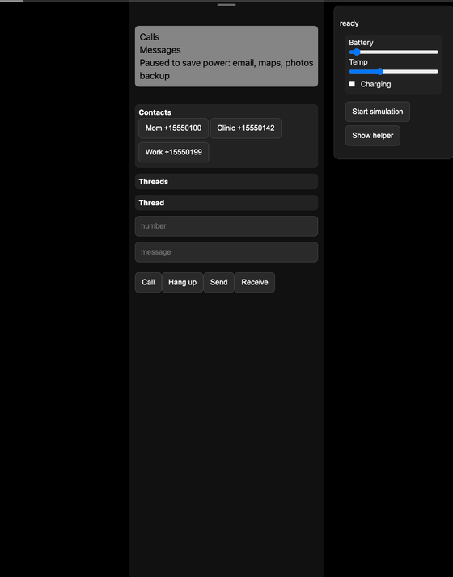
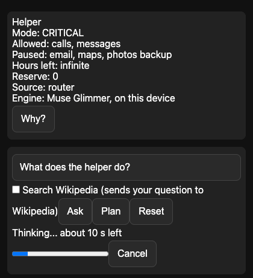
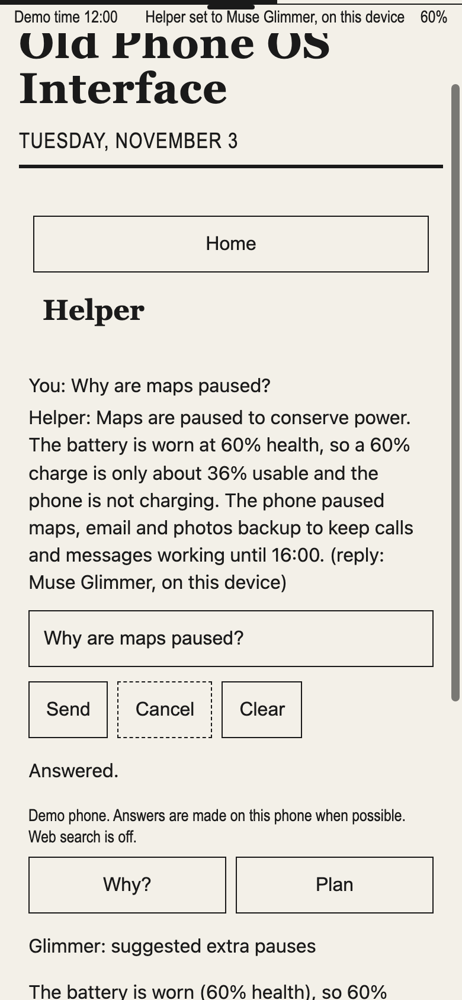

<!-- SPDX-License-Identifier: GPL-3.0-or-later -->
# Old Phone OS Interface (OPOS)

OPOS is Louis Calata's solo entry in the Meta Global AI Developer Hackathon with Cerebral Valley (November 2026). It is a hackathon prototype, not a finished product.

You keep an older phone whose worn battery usually dies by mid-afternoon. With OPOS, maps and photo backup stay paused while calls and messages stay on. The call that matters in the evening still comes through. This is the scenario the simulation models.

OPOS is a prototype phone interface for people who keep an older phone as its battery wears out. It pauses less essential work such as email, maps and photos backup so the battery can last until a time the owner chooses, while calls and messages stay on. Optional open-weight Meta Muse Glimmer 30B runs on the owner's computer, explains decisions in plain words when asked, and may pause extra tasks but never re-enables anything the rules paused or touches calls, messages or alarms; the rules work without it. Try the desktop demo below: it simulates battery, calls and messages and needs only Python 3.11+, no account or model download. The postmarketOS kiosk runs the same simulation: it does not yet read the phone's real battery or use its modem.

## Quickstart

```sh
PYTHONPATH=src python3 -m opos.web --port 8765
```

Open `http://127.0.0.1:8765/`, unlock the screen and select Phone, Messages, Helper or Settings. Run the command from the repository root. The demo is a simulation: physical phones and on-phone model inference are not tested (see [Limits](#limits)).

Demo walkthrough:

1. Open `http://127.0.0.1:8765/?demo=1` for simulator controls.
2. The demo starts at 60% battery with 60% battery health, so about 36% is usable. OPOS calls a battery worn below 80% health, so this one is worn, but its worn-battery reserve stays off: the reserve engages only below 50% health, and the demo cannot change health (the reserve is shown in the [simulations](#simulation-results)). To last until the demo's 16:00 goal it pauses maps and photos backup; calls, messages and email stay on, and with the helper shown, Muse Glimmer's background advisor may pause email too.
3. Tap the thin bar at the top to open battery details and click Start simulation to watch it drain.
4. Click Show helper and try Why?, Plan or type a question such as "Why are maps paused?" and Ask. Muse Glimmer answers from the phone's facts. With no model running, Why answers from the rules, Plan keeps a fixed order and Ask says no model is running.
5. Drag the Battery slider below about 25% (under 15% usable). Ask rests to save power, and calls and messages still work.


Recorded earlier from the desktop simulator; it does not show the postmarketOS image or a physical phone.


Wait GIF recorded against a stand-in slow server with simulated answer text. Not actual Glimmer timing.

## Muse Glimmer answering

On November 3, 2026, the OPOS desktop demo (`?demo=1`) ran on Louis's MacBook Pro with LM Studio serving `muse-glimmer-30b` (Meta Muse Glimmer 30B). The simulation was at noon, with 60% battery at 60% health, a 16:00 goal and the helper shown. On-phone inference is untested.

Asked "Why are maps paused?", Muse Glimmer answered in **56.7 seconds in the dark capture** and **42.4 seconds in the light capture**. The screen labels each answer "reply: Muse Glimmer, on this device"; here, "this device" is the MacBook Pro running the desktop demo.

The dark capture's answer, verbatim:

> Maps are paused to preserve power for calls and messages until 16:00. The battery is worn at 60% health, so a 60% charge is only about 36% usable and the phone is not charging. To keep calls and messages working, the phone paused email, maps and photos backup.

Glimmer's background advisor had itself paused email; the battery panel says "Muse Glimmer paused this to save power for calls and messages." The answer reflects that captured state.

<picture>
  <source media="(prefers-color-scheme: dark)" srcset="docs/assets/glimmer-ask-dark.png">
  
</picture>

These are real Ask captures in dark and light appearance. The **Why? button fell back to the rules answer both times** because it reached OPOS's 115-second helper deadline before Glimmer returned visible text. A fix is in progress.

## How it works

Battery state drives a rule decision, then an advisory plan and explanation. Model text cannot enable a task the rule router deferred.

Hard floors come first and nothing the owner does overrides them: calls, messages and alarms are always allowed (the desktop demo simulates calls and messages only); at 45 C or more only essential tasks run, charging or not; on battery, with less than 15% of the charge usable (the battery rules' CRITICAL mode), only essentials run; below a small reserve kept for calls (at least 0.7% charge) only essentials run, even while charging; and the worn-battery reserve, which engages only when battery health is below 50%, may pause other tasks, even the app in use, to keep charge for calls.

Within those floors the router decides what the battery can afford. While charging, other tasks may run. With a daily goal, the energy budget is cumulative: non-essential tasks are funded in a fixed order (useful before optional, then lower cost first, then by name) and each funded task's cost is subtracted before the next is checked. Without a goal, optional tasks need an effective charge of 80 or more and useful tasks need enough charge for 4 hours. Effective charge = level x battery health. The governor intersects the router's choice with its own rule floor, so model advice can only pause more.

Goal-saving pauses, the router's affordability pauses (even when the router reports CRITICAL) and pauses Glimmer adds are soft: the owner's Undo, or using the app in the foreground, may override them. An Undo lasts until the mode changes; a task held by a hard floor shows that floor as its reason and Undo has no effect on it. The mode shown (NORMAL, SAVER or CRITICAL) comes from the router and the battery rules; what runs is decided by the final allowed and paused lists, and each pause shows its reason. The home screen, battery panel, lock screen, helper facts and simulated drain all use the same final decision. See [docs/design-safety-floor.md](docs/design-safety-floor.md).

Agentic loop with visible helper: observe battery state -> decide with router -> plan (Plan proposes an order and does not run the steps itself) -> act -> explain -> undo. Helper text never changes what the phone does; Glimmer's background advisor can pause extra non-essential tasks, never fewer than the router.

Glimmer may only pause additional non-essential tasks. It cannot allow anything the router deferred and cannot touch calls, messages or alarms.

## Meta AI in OPOS

| Route | Purpose | Requirements and scope |
|---|---|---|
| Rules floor | Deterministic decisions and fallback text | No model or provider account. Simulations are not measured battery savings. |
| Muse Glimmer 30B | Routing advice, Why, Plan and Ask | Your own server serving the model id `muse-glimmer-30b` (for example LM Studio) at `http://127.0.0.1:1234/v1`. If port 1234 is taken, set `OPOS_GLIMMER_URL=http://127.0.0.1:<port>/v1` to point OPOS at LM Studio's actual port. On a 64 GB M5 Pro MacBook Pro running Muse Glimmer 30B (Q4_K_M) in LM Studio, answers took about 30-60 seconds in November 2026 tests, most of it hidden reasoning. |
| Llama 3.2 1B/3B | Optional phone-local answers via server at loopback port 8080 | About 1.5/4 GB free memory; phone speed is unmeasured; weights are not shipped. |
| User-owned LAN server | Optional Glimmer endpoint selected with OPOS_LAN_URL | Private-address validation; opt-in. OPOS does not expose a server for you. |
| Wikipedia | Optional snippets for one question | Unchecked-by-default Search Wikipedia option sends that question to Wikipedia. |
| Spark Open | Optional paid hosted route for Why and Plan only when battery estimate falls short of daily goal | Off by default. Needs `OPOS_SPARK_OPEN=1` and `BASETEN_API_KEY`. Ask does not use it. |

Check endpoint with:
```sh
PYTHONPATH=src python3 -m opos.muse --check
```
This check reports the model ids the endpoint serves and `model_served` (whether the exact id `muse-glimmer-30b` is among them); `--check --probe` also sends one short request to confirm the model returns a completion.

## Simulation results

These results use one simulated battery and burst model, varied across profiles; they do not establish battery savings or cut-out rates on real phones. All numbers below simulate the deterministic rule router against fixed rules, with no AI model involved; they are not measurements on a real phone.

Six simulated device profiles, 40 phones each. Important minutes are simulated minutes until the battery is empty or browns out, with calls, messages and alarms allowed throughout; useful minutes add up the minutes email and maps were each allowed to run. Each figure is the average over the 40 phones, rounded to whole minutes.

| Profile | Important minutes, router | Important minutes, rules | Useful minutes, router | Useful minutes, rules |
|---|---|---|---|---|
| Fresh battery | 743 | 437 | 252 | 403 |
| Worn battery | 518 | 325 | 23 | 180 |
| Cold | 619 | 376 | 105 | 281 |
| Hot | 619 | 378 | 104 | 283 |
| Low start | 156 | 155 | 0 | 1 |
| End of life | 338 | 225 | 0 | 88 |

The router buys important minutes by giving up useful minutes in every profile: it allows email and maps for fewer minutes than the fixed rules everywhere, far fewer with a worn battery, and none with a low start or an end-of-life battery.

The router figures in the table come from the full runtime, so in the worn and end-of-life profiles, where battery health can be below 50%, they include the worn-battery reserve's task pauses. A second simulation, of 40 phones with 30-40% battery health, adds the rest of the reserve: burst shaping, which limits call and sync current to what the worn cell can deliver. Each phone runs once with the policy alone and once with the reserve's task pauses and burst shaping added (the router's runs include the task pauses both times); the figures are the averages of those two sets of runs, not a range. Working calls lasted on average 5.52 and 6.54 hours for the router (fixed rules: 3.67 and 4.73 hours). In the first set every simulated phone browned out; in the second none did.

Reproduce: `PYTHONPATH=src python3 -m opos.profiles` (about 10 s) and `PYTHONPATH=src python3 -m opos.evaleol` (about 30 s).

## Install the per-user application

From a checkout of this repository:
```sh
sh install.sh --yes --no-launch
export PATH="$HOME/.local/bin:$PATH"
opos run --defaults
opos status
```

The installer keeps using that source checkout and creates a per-user launcher and virtual environment. Keep the checkout. `--no-launch` leaves setup for the later `opos run` step.

Optional bootstrap: `bootstrap.sh` clones the repository into `$HOME/opos-src` (or `OPOS_SRC_DIR`) and runs `install.sh --yes --no-launch` from that new checkout. The script itself is a file in this repository, so you need a copy of it first, from a checkout or downloaded on its own. If you already have a checkout, run `install.sh` from it as shown above instead.
```sh
OPOS_REPO_URL=https://github.com/louiscalata/old-phone-os OPOS_REF=main sh bootstrap.sh
```

## postmarketOS packages and QEMU

On November 3, 2026, an aarch64 image built from this tree booted in QEMU 9.1.2 (TCG, OpenRC) to the OPOS lock screen about 70 seconds after start, and Unlock reached Home. It used the packaged tinydm Pixman renderer hook without a manual renderer override; the same image without the hook stayed on the console with a GLES2/GBM failure. See [docs/pmos.md](docs/pmos.md) for the recorded run, toolchain and local-source staging.

This later virtual-machine boot result does not close the November 1 integrator report's **integration NOT READY** status: integration acceptance remains outstanding. The earlier private-baseline QEMU run described in [docs/provenance.md](docs/provenance.md#validation-scope) used a manual, QA-only Pixman renderer override. The November 3 image had no model server or route to one; on-phone inference and physical-phone behavior remain untested for this source.

The kiosk starts the same `opos.web` server as the desktop demo, so it uses the same simulated battery (`DrainSim`) and simulated modem (`ScreenModem`): it does not read the phone's battery, place real calls or send real texts. A ModemManager adapter (`src/opos/mm_modem.py`) exists but is not connected yet, and the sysfs battery reader (`src/opos/hw/battery.py`) is used only by setup to describe the device, not by the phone screen.

## Tests

The complete suite also requires Node.js and Git on PATH, permission to bind loopback sockets, and a writable temporary directory outside the checkout. JavaScript checks skip with a reason when Node.js is unavailable. Some fixtures create disposable Git history in that temporary directory and require local commits to succeed.

Run discovery canonically from the checkout root:
```sh
PYTHONPATH=src python3 -m unittest discover -s tests -t .
```

`.github/workflows/tests.yml` runs the same command on Python 3.11 and 3.13 for pushes and pull requests.

Optional repository checks use `python3 guard/check.py`; see [guard/RULES.md](guard/RULES.md).

## Limits

**Focused package inputs; performance gains remain unmeasured.** See [docs/lean.md](docs/lean.md).

Demo is simulation only, and so is the postmarketOS kiosk: both use the simulated battery and modem. No physical phone testing is claimed and native on-phone inference is not tested. On a 64 GB M5 Pro MacBook Pro running Muse Glimmer 30B (Q4_K_M) in LM Studio, answers took about 30-60 seconds in November 2026 tests, most of it hidden reasoning. Ask rests when the mode is Critical and less than 15% of the charge is usable. Spark Open is off by default and requires user credentials. Wikipedia search is opt-in.

The [Windows installer remains untested at runtime](ROADMAP.md#simulated-or-not-yet-verified), and [Surface Duo work is paused](docs/duo-usb-install.md); those paths are documented separately.

## Documentation

- [docs/README.md](docs/README.md): every document, grouped by what you want to do.
- [docs/architecture.md](docs/architecture.md): module map and how a request flows from the page to the governor and to Muse Glimmer.
- [ROADMAP.md](ROADMAP.md): what works today and what comes next.

## Contributions and license

Development used Meta models Muse Glimmer, Muse Spark, Muse Spark Open, Muse Wonder together with Codex, Claude and Grok Bot. The submitter is responsible for the submission. See [NEW-WORK.md](NEW-WORK.md), [WORK-BY-MODEL.md](WORK-BY-MODEL.md), [docs/provenance.md](docs/provenance.md) and [docs/META.md](docs/META.md).

GPL-3.0-or-later; [LICENSE](LICENSE) is retained verbatim. Model materials have separate licenses and are not bundled. [THIRD_PARTY.md](THIRD_PARTY.md) links upstream terms.
