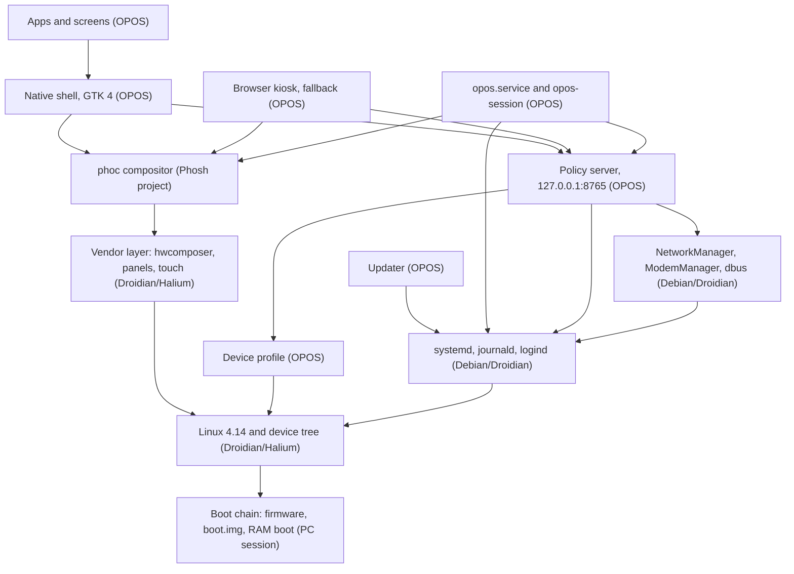

<!-- SPDX-License-Identifier: GPL-3.0-or-later -->
# OS architecture

Status: this page describes the Surface Duo image as `packaging/duo-os/build-image.sh` builds it from this repository.
`tests/test_boot_graph.py` checks it against the unit files on a computer. Nothing on this page was checked on a phone
unless a row says so; the order systemd computes on the phone is **NOT_RUN** (see "What is not proved").

## What OPOS is

OPOS is an operating system for old phones in the sense Android, postmarketOS and Droidian are: a Linux kernel and the
composition around it. On the Surface Duo it is a Droidian rootfs, from the community port, with OPOS's own session,
shell, policy server, apps, updater, image build and checks as the only interface. The image was RAM-booted on one
owner's phone on November 7, 2026; tasks, calls and texts on it are still simulated.

OPOS does not write a kernel, drivers, a bootloader, an init system or a compositor. It takes Linux 4.14 and the device
tree, the vendor layer (hwcomposer, panels, touch, modem, audio in the Android container), systemd and the system
services, and the phoc compositor from Droidian, Halium, Debian and the Phosh project. What OPOS owns, it specifies and
checks: the order its units start in, what happens when one fails, what each one runs, and which files the image holds.

## Layers

An arrow means "depends on". The diagram is `python3 packaging/duo-os/bootgraph.py --layers`; the test compares the
two.



## Who owns what

| Part | Owner | Source or package | How OPOS checks it |
|---|---|---|---|
| Boot chain: firmware, boot.img, RAM boot | Microsoft firmware; the Droidian port; run by the PC session | outside this repository | Never written from a Mac. The booted image is named by its identity (`tools/opos-image-identity.py`). |
| Linux kernel and device tree | Droidian/Halium port | the port's kernel package | Read, not changed. Measured facts against a declared profile are not built yet. |
| Vendor layer in `lxc@android.service` | Droidian/Halium port | the base rootfs | `opos.service` binds to `android-service@hwcomposer.service` and orders after it; `opos-diag` records its state. |
| systemd, journald, logind, dbus, NetworkManager, ModemManager | Debian/Droidian | the base rootfs | Used as they are; no second supervisor. `INHERITED` in `bootgraph.py` lists every one OPOS names. |
| Compositor (phoc) | Phosh project | the base rootfs | OPOS owns only how it starts: `packaging/duo-os/opos-session`, without phoc's shell mode. |
| Session and service graph | OPOS | `packaging/duo-os/*.service`, `*.path`, `*.timer`, `updater/` | `bootgraph.py --check` and `tests/test_boot_graph.py` (this page). |
| Native shell and browser fallback | OPOS | `src/opos/native/`, `packaging/duo-os/opos-native`, `opos-kiosk` | The `OPOS_NATIVE_READY` handshake and the browser hand-over (`packaging/duo-os/NATIVE.md`). |
| Policy server and apps | OPOS | `src/opos/` (`opos.web` on 127.0.0.1:8765) | The unit tests; the API is what the shell and the page call. |
| Updater | OPOS | `packaging/duo-os/updater/`, `tools/opos-release.py` | Signed bundles, rollback (`docs/ota-update.md`). |
| Image, identity and release policy | OPOS | `build-image.sh`, `image-policy.py`, `verify-image.sh` | Hashed manifest, pinned bases, `OPOS_RELEASE=1`. |
| Self-test and diagnostics | OPOS | `opos-selftest`, `opos-diag` | Fail-closed results on the phone (`docs/duo-acceptance.md`); NOT_RUN until run there. |
| Device profile | OPOS | `src/opos/hw/` | `src/opos/hw/device.py` declares the Duo's facts once. The native shell's `posture.py` reads its panel geometry from it; the hand-written copies (the server unit's span, `opos-selftest`, the lid name, the brightness unit) are checked against it, and a leak test fails a new file that repeats a Duo token (`tests/test_hw_facts.py`). |

## Boot sequence

The order below is what the unit files say. Each row names the units of one step; "Waits for" lists units the files
order before it (the test checks every pair), and "Class" is the unit's entry in `FAILURE_CLASS`. Steps 1, 2 and 10 to
11 are not units and are not checked here.

| Step | Unit or program | Class | Waits for | If it fails | Marker |
|---|---|---|---|---|---|
| 1 | firmware and RAM boot (PC session) | - | - | the phone stays in the bootloader | none on the phone |
| 2 | kernel and initramfs (the port) | - | - | no rootfs; nothing below runs | the kernel log |
| 3 | `local-fs.target` | inherited | - | systemd's emergency mode | the journal (persistent) |
| 4 | `opos-update-boot.service` | degrade | `local-fs.target` | the staged update is not applied; the installed release runs | the journal |
| 4 | `opos-brightness.service` | degrade | `local-fs.target` | the panels keep the base's backlight | the journal |
| 5 | `timekeeper.service`, `item-clock-seed.service` | inherited | - | the clock reads 1970 | the journal |
| 5 | `opos-clock.service` | degrade | `timekeeper.service`, `item-clock-seed.service` | the clock is not raised to the image's floor | the journal |
| 6 | `lxc@android.service`, `android-service@hwcomposer.service` | inherited | - | no composer: the session cannot start | `opos-diag` unit states |
| 7 | `opos-server.service` | fatal-to-session | `opos-update-boot.service`, `opos-clock.service`, `lxc@android.service`, `network.target` | restarted every 3 s; the kiosk waits for it, then starts Chromium anyway | the journal |
| 8 | `opos.service` (`opos-session`, phoc) | fatal-to-session | `opos-server.service`, `android-service@hwcomposer.service`, `opos-update-boot.service`, `dbus.socket` | restarted; at its start limit or exit 75, `opos-fallback.service` starts phosh for this boot | the journal |
| 9 | `opos-fallback.service` | degrade | `opos-powerkey.service` | only after the session failed; there is no second fallback | the journal |
| 10 | `opos-kiosk` hands over to `opos-native` | - | - | the browser interface stays (`packaging/duo-os/NATIVE.md`) | `journalctl -t opos-native` |
| 11 | first frame of the native shell | - | - | after 30 s the launcher goes back to the browser | the `OPOS_NATIVE_READY` file |
| 12 | `opos-powerkey.service`, `opos-volumekey.service`, `opos-osk.service` | degrade | `opos.service` | that key or keyboard does nothing; each restarts with the session | the journal |
| 13 | `opos-diag.service` | degrade | `multi-user.target` | no dump for this boot | `/var/log/opos-boot-diag.txt`, 90 s after boot |
| 14 | `opos-update-confirm.service` | degrade | `multi-user.target`, `opos-server.service`, `opos-update-boot.service` | a boot-applied update is not confirmed | the journal |
| on demand | `opos-update.path` | degrade | - | a delivered update is not noticed until the next boot | the journal |
| on demand | `opos-update.service` | degrade | `opos-update.path`, `opos-update-boot.service` | a delivered update waits | the journal |
| dev only | `opos-clock-set.path`, `opos-clock-set.service` | degrade | - | a time file from the PC is not applied | the journal |
| 120 s after boot | `opos-sensorfwd-delayed.timer` | degrade | - | `sensorfwd.service` is not started this boot; nothing else waits for it | the journal |
| 120 s after boot | `opos-sensorfwd-delayed.service` | degrade | `opos-sensorfwd-delayed.timer` | `sensorfwd.service` (inherited, disabled) is not started this boot; nothing else waits for it | the journal |

No step leaves a positive boot marker that names the image yet. A boot is judged today by `opos-selftest`, run by
hand, and by reading the journal and the `opos-diag` dump.

The same order by level, from `python3 packaging/duo-os/bootgraph.py --print`. Units on one level may start together;
"waits for" lists only the direct predecessors once implied orders are left out:

```text
level  unit                                   class             waits for
0      android-service@hwcomposer.service     inherited         -
0      dbus.socket                            inherited         -
0      getty@tty1.service                     inherited         -
0      item-clock-seed.service                inherited         -
0      local-fs.target                        inherited         -
0      lxc@android.service                    inherited         -
0      network.target                         inherited         -
0      opos-clock-set.path                    degrade           -
0      opos-sensorfwd-delayed.timer           degrade           -
0      opos-update.path                       degrade           -
0      plymouth-quit-wait.service             inherited         -
0      rc-local.service                       inherited         -
0      session-c1.scope                       inherited         -
0      systemd-user-sessions.service          inherited         -
0      timekeeper.service                     inherited         -
1      opos-brightness.service                degrade           local-fs.target
1      opos-clock-set.service                 degrade           opos-clock-set.path
1      opos-clock.service                     degrade           item-clock-seed.service, timekeeper.service
1      opos-sensorfwd-delayed.service         degrade           opos-sensorfwd-delayed.timer
1      opos-update-boot.service               degrade           local-fs.target
1      timers.target                          inherited         opos-sensorfwd-delayed.timer
2      opos-server.service                    fatal-to-session  lxc@android.service, network.target, opos-clock.service, opos-update-boot.service
2      opos-update.service                    degrade           opos-update-boot.service, opos-update.path
3      multi-user.target                      inherited         opos-clock-set.path, opos-server.service, opos-update.path
3      opos.service                           fatal-to-session  android-service@hwcomposer.service, dbus.socket, getty@tty1.service, opos-server.service, plymouth-quit-wait.service, rc-local.service, session-c1.scope, systemd-user-sessions.service
4      opos-diag.service                      degrade           multi-user.target
4      opos-osk.service                       degrade           opos.service
4      opos-powerkey.service                  degrade           opos.service
4      opos-update-confirm.service            degrade           multi-user.target
4      opos-volumekey.service                 degrade           opos.service
5      graphical.target                       inherited         multi-user.target, opos-osk.service
5      opos-fallback.service                  degrade           opos-powerkey.service
```

The boot graph, from `python3 packaging/duo-os/bootgraph.py --mermaid`. A solid arrow means "waits for" (`After=`,
`Before=`, and a target after the units it wants); a dotted arrow means "starts" (a path or timer unit's trigger, or
`OnFailure=`). Dashed boxes are inherited units; thick boxes are fatal to the session.

```mermaid
flowchart TD
  android_service_hwcomposer_service["android-service@hwcomposer.service"]
  dbus_socket["dbus.socket"]
  getty_tty1_service["getty@tty1.service"]
  graphical_target["graphical.target"]
  item_clock_seed_service["item-clock-seed.service"]
  local_fs_target["local-fs.target"]
  lxc_android_service["lxc@android.service"]
  multi_user_target["multi-user.target"]
  network_target["network.target"]
  opos_brightness_service["opos-brightness.service"]
  opos_clock_set_path["opos-clock-set.path"]
  opos_clock_set_service["opos-clock-set.service"]
  opos_clock_service["opos-clock.service"]
  opos_diag_service["opos-diag.service"]
  opos_fallback_service["opos-fallback.service"]
  opos_osk_service["opos-osk.service"]
  opos_powerkey_service["opos-powerkey.service"]
  opos_sensorfwd_delayed_service["opos-sensorfwd-delayed.service"]
  opos_sensorfwd_delayed_timer["opos-sensorfwd-delayed.timer"]
  opos_server_service["opos-server.service"]
  opos_update_boot_service["opos-update-boot.service"]
  opos_update_confirm_service["opos-update-confirm.service"]
  opos_update_path["opos-update.path"]
  opos_update_service["opos-update.service"]
  opos_volumekey_service["opos-volumekey.service"]
  opos_service["opos.service"]
  plymouth_quit_wait_service["plymouth-quit-wait.service"]
  rc_local_service["rc-local.service"]
  session_c1_scope["session-c1.scope"]
  systemd_user_sessions_service["systemd-user-sessions.service"]
  timekeeper_service["timekeeper.service"]
  timers_target["timers.target"]
  graphical_target --> multi_user_target
  graphical_target --> opos_osk_service
  multi_user_target --> opos_clock_set_path
  multi_user_target --> opos_server_service
  multi_user_target --> opos_update_path
  opos_brightness_service --> local_fs_target
  opos_clock_service --> item_clock_seed_service
  opos_clock_service --> timekeeper_service
  opos_clock_set_path -. starts .-> opos_clock_set_service
  opos_diag_service --> multi_user_target
  opos_fallback_service --> opos_powerkey_service
  opos_osk_service --> opos_service
  opos_powerkey_service --> opos_service
  opos_sensorfwd_delayed_timer -. starts .-> opos_sensorfwd_delayed_service
  opos_server_service --> lxc_android_service
  opos_server_service --> network_target
  opos_server_service --> opos_clock_service
  opos_server_service --> opos_update_boot_service
  opos_service --> android_service_hwcomposer_service
  opos_service --> dbus_socket
  opos_service --> getty_tty1_service
  opos_service --> opos_server_service
  opos_service --> plymouth_quit_wait_service
  opos_service --> rc_local_service
  opos_service --> session_c1_scope
  opos_service --> systemd_user_sessions_service
  opos_service -. OnFailure .-> opos_fallback_service
  opos_update_boot_service --> local_fs_target
  opos_update_confirm_service --> multi_user_target
  opos_update_path -. starts .-> opos_update_service
  opos_update_service --> opos_update_boot_service
  opos_volumekey_service --> opos_service
  timers_target --> opos_sensorfwd_delayed_timer
  classDef inherited stroke-dasharray: 4 3
  classDef fatal stroke-width: 3px
  class android_service_hwcomposer_service,dbus_socket,getty_tty1_service,graphical_target,item_clock_seed_service,local_fs_target,lxc_android_service,multi_user_target,network_target,plymouth_quit_wait_service,rc_local_service,session_c1_scope,systemd_user_sessions_service,timekeeper_service,timers_target inherited
  class opos_server_service,opos_service fatal
```



## When something fails

- **Fatal to the session.** `opos.service` (the session: `opos-session`, phoc and the kiosk) and `opos-server.service`.
  The session restarts itself. When the kiosk gives up on Chromium, `opos-session` exits 75; `opos.service` does not
  restart on 75 (`RestartPreventExitStatus=75`), so it fails at once and `OnFailure=opos-fallback.service` starts
  phosh for this boot. The same happens at the session's start limit. The vendor composer is inherited but bound to the
  session (`BindsTo=`): when it stops, the session stops with it. A server that is down does not start the fallback:
  it is restarted every 3 s, and the kiosk waits for it and then starts Chromium anyway, so the screen shows the page's
  error until the server answers.
- **Degrade and continue.** Every other OPOS unit. No fatal unit has `Requires=`, `BindsTo=` or `Requisite=` on one of
  them, so their failure cannot take the session down. Within the session the native shell degrades to the browser
  kiosk (exit 10: the owner chose the old interface; exit 11: a PIN lock the shell cannot show; no window within 30 s;
  3 ends within 20 s; 6 ends within 10 minutes).

## Contracts

- The policy server listens on 127.0.0.1:8765 and is started with `--token-file %S/opos/token`; which calls need the
  token is set in `src/opos/web.py`.
- The native shell writes the file named in `OPOS_NATIVE_READY` once its window is up; `opos-native` waits 30 s for it.
- Exit codes: 10 and 11 from the native shell (to the browser), 75 from `opos-session` (to phosh).
- The `OPOS_*` switches are listed in [The Duo OS as it stands](duo-os-final.md) and are not repeated here.

## Device layer

The profile lives in `src/opos/hw/`. A second phone is meant to be a second profile there, not a second tree. A phone
is supported only once `opos-selftest` has passed on it; the Surface Duo has not had that run recorded.

## What is not proved

- **The order on the phone.** This page and its test model systemd's rules from the files. They leave out
  `DefaultDependencies=` ordering against `basic.target` and `shutdown.target`, and summarize the order between the
  inherited targets. `systemd-analyze verify` and `systemd-analyze critical-chain opos.service` on the booted image are
  **NOT_RUN** (PC session).
- **An emulated boot.** No boot of this image in an emulator has been run; it is **NOT_RUN**.
- **Measured hardware facts.** The Duo's span, panel size and devices are written by hand; comparing them with what the
  kernel reports is **NOT_RUN**.
